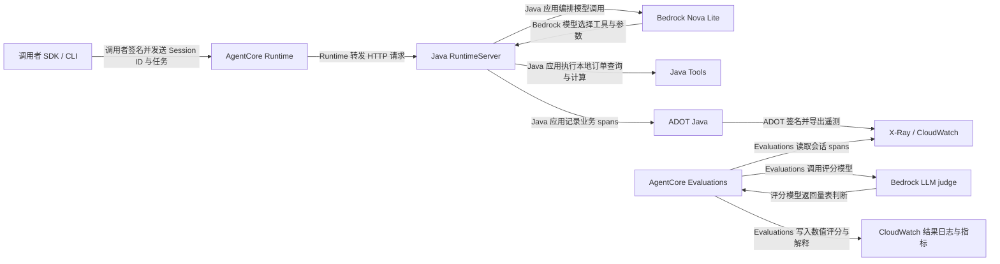

# Java Runtime 设计

日期：2026-10-12。

## 组件与动作

## 部署决策

部署执行者保留用户现有 Java 代码，使用 Java 21 自定义 ARM64 镜像与 HTTP 协议，PUBLIC 网络及 SigV4 认证。参考工作区 E2E 项目的部署流程；自定义 Java 镜像需要部署脚本显式构建、推送 ECR 并调用 Runtime 控制面 API，避免 Python starter toolkit 自动生成的入口替换 Java 程序。

Java RuntimeServer 监听 8080。Java 服务验证 JSON 请求、长度和 Session ID，为每次请求创建 MinimalAgent，返回结构化结果。Java HTTP 线程池允许 /ping 在模型调用期间响应。ADOT provider 在进程中共享；Java 应用为每次请求创建独立业务 spans。

部署执行者创建独立 ECR 仓库、Runtime 执行角色及评估配置。角色把模型调用、镜像读取和日志访问限制到本次资源。AWS 的 ECR token 与 X-Ray 写入 API 不支持资源级 ARN；部署脚本仅对必需的明确 action 使用 Resource=*，辅以 Region 条件，依据官方 Runtime permissions。这是 AWS API 限制，并非业务资源全权限。Runtime 信任策略限制来源账户及本次 Runtime 名称。

部署脚本保存不可变镜像版本及状态；任何 Runtime 更新后，部署执行者核对 DEFAULT Endpoint 的版本。新建资源默认保留，部署脚本不提供自动清理。

## Java 遥测封装

Java 业务类 MinimalAgent 通过 AgentTelemetry 的 agent/chat/tool 三个入口记录遥测。AgentTelemetry 使用标准 OTel API 管理 span、Session、GenAI 字段和异常；外置 ADOT JAR 通过 -javaagent 提供共享 provider、签名及导出。测试执行者只在 Maven test scope 使用本地 SDK 验证 span 契约，生产应用不初始化第二个 SDK。变量读取者及配置说明见 [Java Trace 与环境变量](telemetry-configuration.md)。

## 验证

测试执行者先执行本地 HTTP 协议与参数校验测试，再运行两个真实 Runtime 会话。部署执行者用返回的 Session ID / Trace ID 对照 CloudWatch spans 与评分，检查未签名调用被拒绝。部署执行者将真实资源标识与原始遥测保存在源码仓库之外。

## 实测补充

部署执行者将在部署完成后记录实际差异与排错结果。
